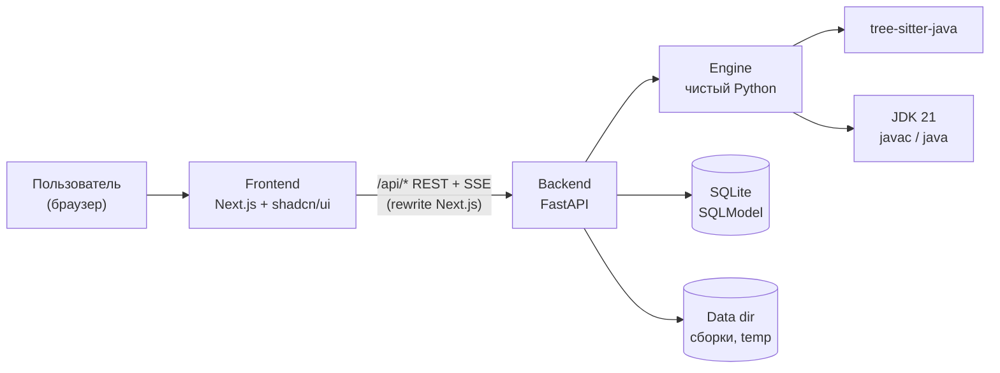
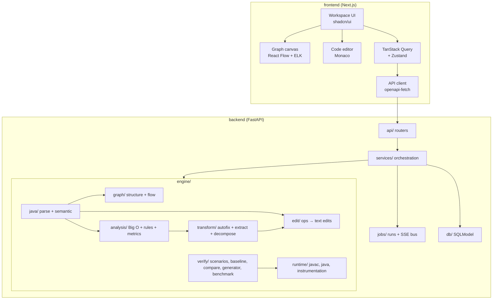
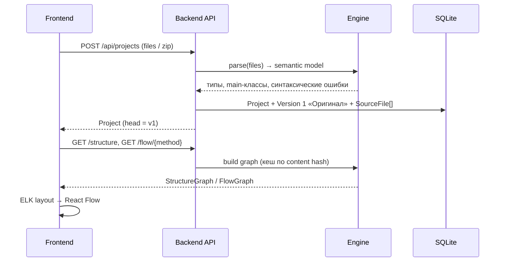
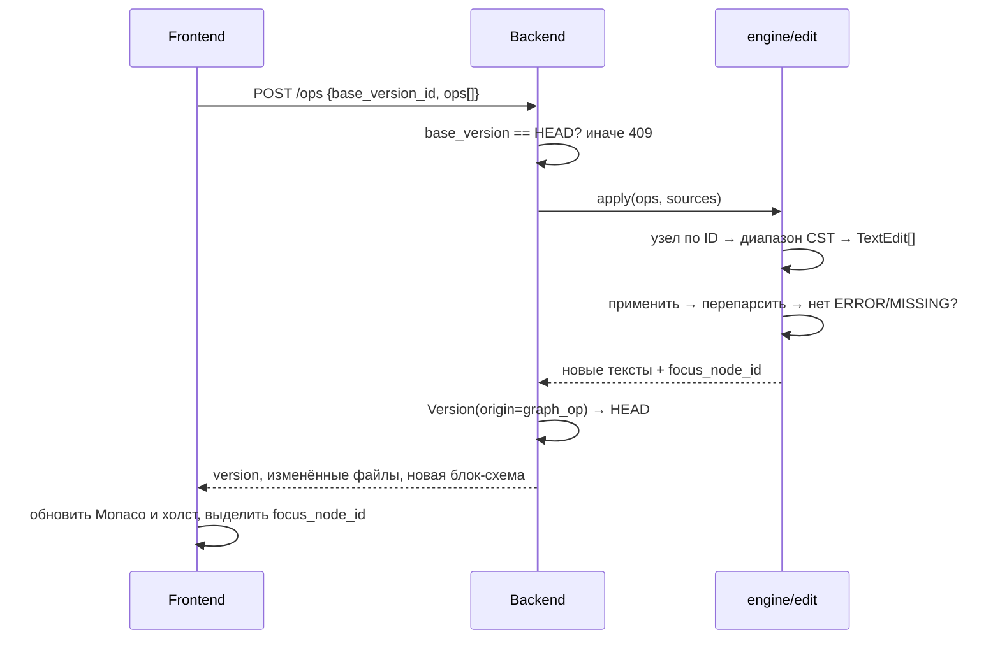
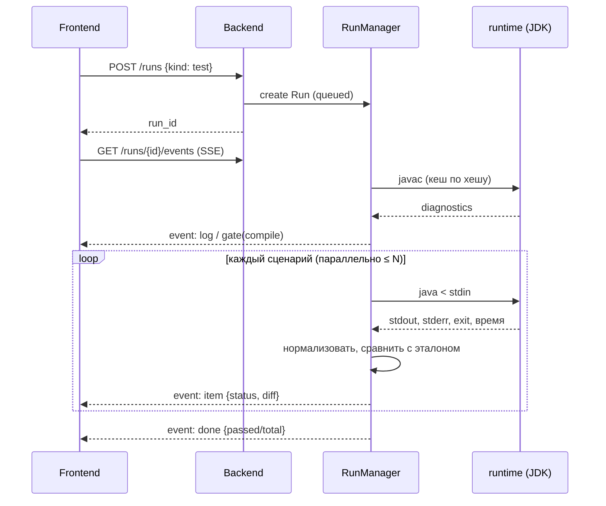

# 02. Архитектура

## 1. Контекст



Два процесса (два контейнера): `frontend` (Next.js) и `backend` (FastAPI + JDK). Браузер ходит только во frontend; запросы `/api/*` Next.js проксирует в backend (rewrites), поэтому CORS не нужен и наружу открыт один порт.

## 2. Принципы

1. **Код — источник истины.** Граф (структура и блок-схемы) — это вычисляемая проекция текста Java. Граф нигде не хранится, только кешируется по хешу содержимого.
2. **Правка графа = операция → правка текста.** Frontend посылает операцию (`insert_node`, `update_node`…); backend превращает её в минимальные текстовые правки по диапазонам синтаксического дерева. Нетронутый код (форматирование, комментарии) не меняется.
3. **Любое изменение кода создаёт версию.** Версии иммутабельны. HEAD — указатель; undo/redo — его перемещение.
4. **Engine отделён от веба.** Пакет `engine` не зависит от FastAPI и БД: функции принимают текст и модели и возвращают модели. Поэтому его легко тестировать на корпусе примеров.
5. **Детерминизм.** Анализ, генерация сценариев (фиксированный seed) и декомпозиция при одном и том же входе дают один и тот же результат.
6. **Quality gate на всех автоматических преобразованиях.** Автоисправление, оптимизация, выделение метода и декомпозиция становятся HEAD только после успешной компиляции и прогона всех сценариев.

## 3. Компоненты



### 3.1 Модули backend

| Модуль | Ответственность |
|---|---|
| `app/api` | FastAPI-роутеры: projects, versions, files, graph, ops, analysis, transform, scenarios, runs, export, health. Только валидация и вызов сервисов |
| `app/services` | Сценарии использования: «применить операцию», «записать эталон», «применить исправление через gate». Транзакции БД, создание версий |
| `app/jobs` | `RunManager`: фоновые задачи на asyncio, статусы, отмена, буфер событий для SSE |
| `app/db` | SQLModel-модели, сессии, `create_all`, режим WAL |
| `engine/java` | Разбор tree-sitter, обход CST, семантическая модель: типы, члены, области видимости, символы, вызовы, чистота методов |
| `engine/graph` | Построение графа структуры и блок-схем, стабильные ID узлов, рёбра управления, перевод диапазонов в UTF-16 |
| `engine/edit` | Операции над графом → `TextEdit`; шаблоны генерации; валидация фрагментов; отступы; переименование |
| `engine/analysis` | Модель стоимости, оценка Big O, каталог правил, метрики, поиск клонов |
| `engine/transform` | Автоисправления (OPT/FIX/CLEAN), выделение метода, декомпозиция |
| `engine/runtime` | Материализация исходников, `javac`, `java`, лимиты, разбор диагностик компилятора, инструментирование (`JbTrace`) |
| `engine/verify` | Сценарии, эталоны, нормализация, сравнение, отчёты, генератор сценариев, бенчмарк |

### 3.2 Модули frontend

| Модуль | Ответственность |
|---|---|
| `app/` (routes) | `/` — проекты и импорт; `/projects/[id]` — рабочая область |
| `components/workspace` | Каркас по макету: шапка, левая колонка (проект, блоки), центр (вкладки, холст), правая колонка (анализ), нижние панели (код, консоль, тесты) |
| `components/graph` | Кастомные узлы React Flow по типам блоков, рёбра, контейнеры, оверлеи (диагностика, покрытие, трассировка), раскладка ELK в Web Worker |
| `components/code` | Monaco: подсветка Java, декорации выделенного узла, маркеры находок и ошибок компиляции, diff-редактор |
| `components/analysis` | Проблемы, рекомендации, метрики, сложность, оценка ускорения, предпросмотр исправлений |
| `components/tests` | Сценарии, результаты, diff вывода, покрытие, экспорт отчёта |
| `components/decompose` | План декомпозиции «до/после», перенос методов между кластерами |
| `lib/api` | Сгенерированные типы OpenAPI + клиент `openapi-fetch`, хуки TanStack Query, подписка на SSE |
| `stores` | Zustand: активный файл и метод, выделение, режим вида, оверлеи, вкладки панелей |

## 4. Ключевые потоки

### 4.1 Импорт и построение графа



### 4.2 Правка графа → код



Если после правки дерево содержит ошибки, операция отклоняется (`422 INVALID_FRAGMENT`), HEAD не меняется.

### 4.3 Правка кода → граф

1. Пользователь печатает в Monaco. Через 400 мс после паузы frontend вызывает `POST /api/parse` (без сохранения) и получает схему активного метода и синтаксические ошибки — так граф обновляется «вживую».
2. Через 800 мс после паузы (или по Ctrl+S) — `PUT /files/{path}`: создаётся версия `origin=code_edit`. Подряд идущие правки кода **схлопываются** в одну версию, если HEAD — тоже `code_edit` и между ними не было других операций.
3. При синтаксической ошибке холст показывает последнюю корректную схему с баннером ошибки; операции над графом блокируются, пока код не станет корректным.

### 4.4 Прогон тестов



### 4.5 Автоисправление через quality gate

1. `POST /fixes/{fix_id}/preview` — engine проверяет предусловия, строит правки, возвращает diff, ожидаемый эффект и флаг `behavior_preserving`.
2. `POST /fixes/{fix_id}/apply` — создаётся **кандидат-версия** (ещё не HEAD), затем запускается Run `kind=gate`: синтаксис → компиляция → все сценарии.
3. Успех → кандидат становится HEAD (`gate_status=passed`). Провал → кандидат помечается `rejected`, HEAD не меняется, пользователь видит diff упавших сценариев.
4. Для исправлений, которые меняют поведение (FIX-*), провал ожидаем. Пользователь видит, какие сценарии изменились, и может подтвердить — тогда кандидат становится HEAD, а эталоны этих сценариев перезаписываются на новую версию (с записью в историю).

## 5. Хранение

### 5.1 SQLite (SQLModel)

| Таблица | Поля (основные) | Назначение |
|---|---|---|
| `project` | id, name, created_at, updated_at, main_class, original_version_id, head_version_id, baseline_version_id, settings (JSON: locale, таймауты, пороги правил) | Проект |
| `version` | id, project_id, number, parent_id, origin (`upload`/`code_edit`/`graph_op`/`autofix`/`optimize`/`extract_method`/`decompose`/`revert`), description, content_hash, status (`active`/`candidate`/`rejected`), gate_status (`unknown`/`passed`/`failed`), gate_run_id, meta (JSON: операции, fix_id, перемещения символов) | Снимок проекта |
| `source_file` | id, version_id, path, content, sha256 | Файлы версии (≈40 КБ на версию — дёшево) |
| `scenario` | id, project_id, name, description, stdin, args (JSON), source (`manual`/`imported`/`generated`/`scaled`), size_factor, enabled, stability (`stable`/`masked`/`nondeterministic`), masks (JSON), created_at | Входные данные |
| `baseline` | id, project_id, scenario_id, version_id, stdout, stderr, exit_code, exception (JSON), duration_ms, coverage (JSON), created_at | Эталон сценария; на сценарий активен один |
| `run` | id, project_id, version_id, kind (`run`/`test`/`gate`/`baseline`/`generate`/`benchmark`/`trace`/`verify`), status, started_at, finished_at, summary (JSON) | Фоновая задача и её итог |
| `run_item` | id, run_id, scenario_id (nullable), status, stdout, stderr, exit_code, duration_ms, diff (JSON), hits (JSON), op_count | Результат одного запуска |

- Таблицы создаются через `SQLModel.metadata.create_all` при старте; миграций нет (хакатон).
- `PRAGMA journal_mode=WAL`, `foreign_keys=ON`.
- Сессии синхронные (FastAPI выполняет sync-зависимости в threadpool); фоновые задачи открывают свои сессии.

### 5.2 Файловая система (`JB_DATA_DIR`)

```
/data/
├── app.db                          # SQLite
├── builds/<content_hash>/          # скомпилированные классы (кеш)
│   ├── src/…                       # материализованные исходники
│   └── classes/…
├── builds/<content_hash>-trace/    # инструментированная сборка + таблица узлов
└── tmp/run-<id>/                   # рабочие каталоги запусков (удаляются)
```

### 5.3 Кеши в памяти

LRU по `content_hash` (+ путь файла): CST, семантическая модель, граф структуры, блок-схемы, результат анализа. При 1000 строках пересчёт стоит десятки миллисекунд, кеш нужен для частых запросов от UI.

## 6. Фоновые задачи и SSE

- `RunManager` — in-process реестр asyncio-задач. Каждая задача пишет события в свой буфер (replay для поздних подписчиков) и сохраняет итог в `run`/`run_item`.
- Параллелизм JVM ограничен `asyncio.Semaphore(JB_MAX_PARALLEL_RUNS)` (по умолчанию — число CPU).
- SSE (`sse-starlette`): события `status`, `log`, `item`, `gate`, `done`, `error` (см. [08-api.md § 9](08-api.md#9-sse-события)).
- Backend запускается **одним** worker-процессом uvicorn: реестр задач живёт в памяти. Для хакатона это допустимо.
- При рестарте незавершённые Run помечаются `error` («прерван перезапуском»).

## 7. Исполнение Java и изоляция

Подробно — в [07-behavior-verification.md § 2](07-behavior-verification.md#2-исполнение-java). Кратко:

- `javac --release 21 -encoding UTF-8 -g`, затем `java` с фиксированными кодировками и локалью, `-Xmx256m`, таймаутом и лимитом вывода.
- Каждый запуск — отдельный временный каталог и подпроцесс от непривилегированного пользователя `runner`; на Linux — `setrlimit` (CPU, размер файлов, число процессов).
- Скомпилированные классы кешируются по хешу содержимого версии.

## 8. Обработка ошибок

| Ситуация | Поведение |
|---|---|
| Синтаксическая ошибка в коде | Граф строится частично; узлы с `ERROR` помечены; операции над графом блокируются |
| Невалидный фрагмент в операции | `422 INVALID_FRAGMENT` с указанием поля и причины |
| Устаревшая базовая версия операции | `409 VERSION_CONFLICT`, frontend перезапрашивает HEAD |
| Предусловие автоисправления не выполнено | `422 PRECONDITION_FAILED` со списком проверок |
| Ошибка компиляции | Диагностика привязана к файлу, строке и узлу; gate проваливается на стадии `compile` |
| Таймаут / превышение вывода | Статус сценария `timeout` / `output_limit`; процесс завершается вместе с дочерними |
| Неожиданная ошибка engine | `500` с `error.code=INTERNAL` и correlation id в логах |

Формат ошибки — единый: `{"error": {"code", "message", "details"}}`.

## 9. Производительность

| Операция | Бюджет | Как достигаем |
|---|---|---|
| Разбор + граф, 1000 строк | ≤ 300 мс | tree-sitter (единицы мс), кеш по хешу |
| Операция над графом | ≤ 500 мс | Точечные правки + перепарсинг одного файла |
| Анализ проекта | ≤ 1 с | Один проход по семантической модели, мемоизация стоимости методов |
| Компиляция | ≈ 1–2 с | Кеш сборок по хешу |
| Gate, 15 сценариев | ≤ 20 с | Параллельные JVM, `-XX:TieredStopAtLevel=1 -Xshare:auto` для коротких запусков |
| Раскладка схемы, 150 узлов | ≤ 500 мс | ELK в Web Worker |

## 10. Ограничения архитектуры

- Один процесс backend, без горизонтального масштабирования (реестр задач в памяти).
- Пользовательский код выполняется в контейнере backend без сетевой изоляции. Допустимо, потому что монолиты присылают организаторы (доверенный вход); ограничение зафиксировано в описании решения.
- Нет аутентификации и многопользовательского режима — вне рамок кейса.
